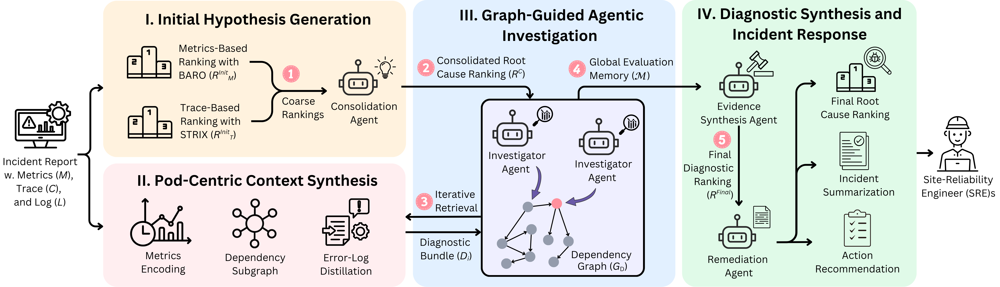

# GALA: Graph-Augmented LLM Agents for Root Cause Analysis and Incident Response in Microservices [ASE 2026]


This repository accompanies our paper. It contains the supplementary technical report, the
human-annotated evaluation data, sample outputs, and the third-party baseline frameworks used
in our experiments.



Maintainer: Yifang Tian (yifang.tian@mail.utoronto.ca)

## Highlights

- Multi-modal RCA over metrics, logs, and traces.
- Graph-guided agentic investigation with iterative re-ranking.
- Incident summary and action recommendation generation.
- SURE-Score tooling for LLM-based RCA report evaluation.

## Implementation Availability

The software underlying this work was developed under a collaborative research agreement with our industrial partner, whose terms preclude public release of the source code. To support reproducibility, the paper reports the complete algorithm specifications, system parameters, workload configurations, and hardware setup used in all experiments. Aggregate measurement data are available from the corresponding author on reasonable request, subject to the partner's approval.


## Data

### Annotated evaluation set

[data/annotated_dataset.csv](data/annotated_dataset.csv) contains the human-written gold-standard
incident summaries and remediation recommendations used as the reference for report-quality
evaluation. The procedure used to produce it is documented in
[annotation_guidelines.md](annotation_guidelines.md).

### Benchmark datasets

Experiments run on the RCAEval RE2 datasets. Download them with the helper shipped inside the
vendored RCAEval tree:

```bash
mkdir -p data/RCAEval && cd data/RCAEval
PYTHONPATH=../../baselines/RCAEval python ../../baselines/RCAEval/script/download_dataset.py
```

Datasets land under `data/RCAEval/data`.

## Sample Output

[sample_output/](sample_output/) shows the artifact formats produced for a single incident
(`ts-order-service_cpu`, case 1): the base ranking, the STRIX trace ranking, the agent
reasoning history, and the generated summary with recommendations.

## Baselines

The baseline frameworks used in our comparison are vendored under [baselines/](baselines/):

| Baseline | Location |
| --- | --- |
| RCAEval (BARO, CIRCA, RCD, PC/LiNGAM/Granger-PageRank, TraceRCA, …) | `baselines/RCAEval` |
| mABC | `baselines/mabc` |
| OpenRCA | `baselines/openrca` |
| Nezha | `baselines/nezha` |

**Flow-of-action is not included in this repository.** Please contact its original authors to
obtain the implementation.

See [baselines/README.md](baselines/README.md) for per-baseline run instructions.

## Requirements

- Python 3.10 or newer.
- API credentials for the model providers you plan to use.
- Linux/macOS shell environment.

[requirements.txt](requirements.txt) and [requirements_full.txt](requirements_full.txt) record
the environment our experiments ran in; the latter is a frozen lock file for strict replay.

## Hardware and Runtime Notes

- Typical environment: Linux VM/server, Python 3.10+, no mandatory GPU for API-based runs.
- Runtime: mostly API-latency bound; full runs vary by provider rate limits and dataset size.
- Cost: API spend depends on the selected model/provider mix and the number of repetitions.

## Repository Structure

- `techinical_report`: ACM-formatted supplementary technical report.
- `data`: annotated evaluation set and the download location for benchmark datasets.
- `sample_output`: example output artifacts for one incident.
- `baselines`: third-party baseline frameworks.
- `assets`: figures.
- `LICENSES`: third-party license notices.

## License

This repository is licensed under MIT. See [LICENSE](LICENSE).

Third-party components included in this repository carry additional license terms. See
[LICENSES](LICENSES/) and the license files inside each `baselines/` subdirectory.
